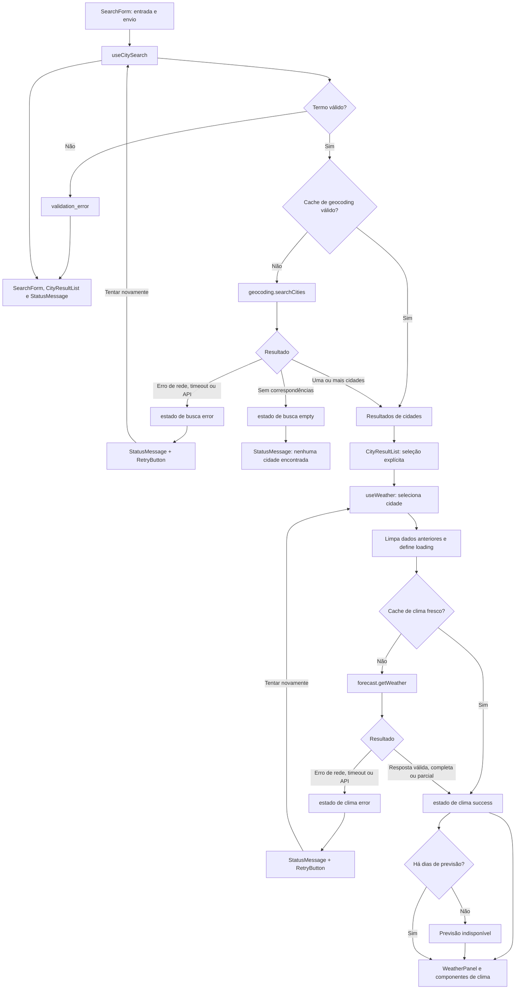

# Plano Técnico — Aplicação de Previsão do Tempo

> Fonte da verdade: [specs/weather-app-spec.md](../specs/weather-app-spec.md).
> Este plano define decisões, contratos (tipos/interfaces) e estrutura. Não contém
> o código final. Referências `RF-`, `RNF-`, `CA-`, `D-`, `A-` e `R-` apontam para a spec.

## 1. Architecture Overview

Aplicação **SPA estática** que consome diretamente duas APIs públicas da
Open-Meteo. Sem conta, sem banco, sem servidor próprio e sem telemetria (RNF-07).

```text
┌─────────────────────────────────────────────────────────────────────┐
│ Apresentação — src/components/                                      │
│ componentes visuais recebem dados/ações por props e emitem eventos │
├─────────────────────────────────────────────────────────────────────┤
│ Composição e orquestração — App.tsx + src/hooks/                    │
│ App conecta a tela; hooks coordenam estado, efeitos e fluxo assíncrono│
├─────────────────────────────────────────────────────────────────────┤
│ Acesso a dados — src/services/                                      │
│ HTTP, APIs Open-Meteo, DTOs → modelos da aplicação e cache em memória│
├─────────────────────────────────────────────────────────────────────┤
│ Funções puras — src/lib/                                            │
│ normalização, validação, conversões, arredondamento e formatação    │
└─────────────────────────────────────────────────────────────────────┘
       │ HTTPS (GET)                              │ localStorage
       ▼                                          ▼
Open-Meteo                                preferência de unidade
```

O fluxo de dependências segue uma direção única: `App` compõe componentes e
hooks; hooks chamam serviços e funções puras; serviços usam funções puras para
normalização/mapeamento quando necessário. `components/` não acessa APIs nem
armazena estado de domínio, `services/` não importa React e `lib/` não conhece
React, rede ou armazenamento do navegador. Os contratos compartilhados ficam
em `types/` e DTOs da API permanecem restritos aos serviços.

Princípios:

- **Apresentação separada da orquestração:** componentes exibem props e chamam
  callbacks; hooks concentram estado, efeitos, concorrência e persistência local.
- **Integrações isoladas:** somente `services/` usa `fetch`; hooks dependem dos
  contratos de serviços, não de detalhes de URL ou formato bruto da API.
- **Funções puras previsíveis:** `lib/` recebe valores e retorna resultados, sem
  efeitos colaterais, facilitando testes determinísticos.
- **Sem roteamento** (D-04, A-15): uma única tela com estados.
- **Sem biblioteca de estado ou de data-fetching** (ver §7 e §12).

## 2. Tech Stack

| Camada | Escolha | Justificativa / rastreio |
| --- | --- | --- |
| Linguagem | TypeScript `strict` | Contratos explícitos para respostas da API e estados. |
| UI | React + Vite | Stack definida no projeto; SPA estática. |
| Estilo | Tailwind CSS, tema escuro fixo | Glassmorphism escuro (D-06, RNF-17). Sem seletor de tema. |
| Ícones | SVG vetorial próprio em `src/components/icons/`, `aria-hidden` | CA-03.6: ícone decorativo sem dependência extra. |
| Testes unitários/integração | Vitest + Testing Library (`jsdom`) | Stack definida no projeto. |
| Testes E2E | Playwright + `@axe-core/playwright` | RNF-04 exige auditoria automatizada; RNF-08 exige matriz de navegadores. |
| Pacotes | pnpm | Stack do projeto. |
| Lint/format | Biome | Stack do projeto. |
| Persistência | `localStorage` (somente a unidade) | RF-07, A-05. Sem backend. |
| HTTP | `fetch` nativo + `AbortController` | Timeout de 10 s (CA-05.2, Edge Cases). Evita dependência de data-fetching. |

Não serão adotados: React Router (A-15), Redux/Zustand/React Query (o estado é
pequeno e local, ver §7), bibliotecas de datas (`Intl` e `Date` bastam) e
qualquer SDK de analytics (RNF-07).

## 3. Project Structure

```text
src/
├── main.tsx                      # inicialização do React
├── App.tsx                       # composição da página; conecta hooks e componentes
├── index.css                     # diretivas Tailwind + tokens do tema escuro
├── components/
│   ├── SearchForm.tsx            # entrada e callbacks de busca; sem chamada de API (RF-01)
│   ├── CityResultList.tsx        # resultados e seleção explícita (RF-02)
│   ├── WeatherPanel.tsx          # composição visual dos dados de clima selecionados
│   ├── CurrentWeatherCard.tsx    # dados atuais (RF-03)
│   ├── ForecastList.tsx          # lista dos cinco dias (RF-04)
│   ├── ForecastDayItem.tsx       # apresentação de um dia
│   ├── UnitToggle.tsx            # controle de unidade por callback (RF-05, RF-06)
│   ├── StatusMessage.tsx         # loading / erro / vazio, com role e aria-live (RF-12)
│   ├── RetryButton.tsx           # ação de nova tentativa (RF-10)
│   ├── Footer.tsx                # atribuição Open-Meteo + aviso (RF-15)
│   ├── WeatherIcon.tsx           # ícone acessível/decorativo por código WMO
│   └── icons/                    # SVGs individuais
├── hooks/
│   ├── useUnitPreference.ts      # estado da unidade e persistência/fallback (RF-07, RF-13)
│   ├── useCitySearch.ts          # estado/fluxo de busca e descarte de respostas antigas (RF-01, RF-08, RF-09)
│   └── useWeather.ts             # cidade ativa, carregamento, cache e retry (RF-03, RF-04, RF-11)
├── services/
│   ├── http.ts                   # transporte HTTP, timeout de 10 s e erro tipado
│   ├── geocoding.ts              # Open-Meteo geocoding: DTO → City[] (RF-01, RF-02)
│   ├── forecast.ts               # Open-Meteo forecast: DTO → WeatherData (RF-03, RF-04)
│   └── cache.ts                  # cache em memória com TTL (RNF-16)
├── lib/
│   ├── search-term.ts            # normalização/validação de entrada (RF-14)
│   ├── units.ts                  # conversão e apresentação de temperaturas
│   ├── rounding.ts               # arredondamento half away from zero (RF-16)
│   ├── wmo.ts                    # código WMO → rótulo pt-BR e chave do ícone
│   └── dates.ts                  # datas/horas e regra de frescor (RF-03, RF-04)
└── types/
    ├── city.ts                   # modelo de domínio compartilhado City
    ├── weather.ts                # modelos de domínio do clima
    └── api.ts                    # DTOs externos, importados apenas por services/

tests/
├── unit/
│   ├── lib/                      # funções puras: entradas/saídas e casos de borda
│   ├── services/                 # DTOs, mapeamento, cache e HTTP com fetch mockado
│   └── hooks/                    # estados, efeitos, concorrência e persistência simulados
├── components/                   # Vitest + Testing Library: props, ações e acessibilidade
├── fixtures/                     # respostas controladas da API
└── e2e/                          # Playwright com rede interceptada (R-18)
```

Responsabilidades e limites:

- **`components/` — apresentação:** componentes recebem modelos/estado via props
  e notificam interações via callbacks. Não fazem requisições, não acessam
  `localStorage` e não decidem política de retry/cache. Isso permite renderizá-los
  com dados de teste simples, sem montar APIs nem estado global.
- **`hooks/` — orquestração e estado:** cada hook coordena uma preocupação,
  incluindo estados de loading/erro/vazio, efeitos, cancelamento e persistência
  local quando aplicável. Serviços podem ser substituídos por mocks nos testes
  para validar transições e concorrência sem rede.
- **`services/` — adaptadores de dados:** concentram HTTP, URLs/parâmetros,
  timeout, validação estrutural das respostas, mapeamento de DTO para modelos
  de domínio e cache. Testes usam `fetch` controlado e fixtures para verificar
  contratos sem depender da disponibilidade da Open-Meteo.
- **`lib/` — regras puras:** funções sem I/O nem estado mutável; cada regra pode
  ser testada com entradas e resultados esperados, inclusive limites e valores
  ausentes, de forma rápida e determinística.
- **`types/` — contratos:** tipos de domínio são compartilhados entre camadas;
  DTOs descrevem exclusivamente a fronteira externa e não vazam para UI/hooks.

Regras: um componente por arquivo; somente `services/` realiza `fetch`;
`types/api.ts` é consumido somente por `services/`; não criar dependências de
`components/` para `services/` nem de `lib/` para camadas externas.

## 4. Data Model

Os tipos abaixo são **contratos**. Valores de origem são guardados em **Celsius**
e convertidos apenas na apresentação (CA-04.2, R-11). `null` significa "Dados
indisponíveis" (CA-03.5), nunca `undefined` ou `NaN` na tela.

```ts
// types/city.ts
export interface City {
  id: number;                 // ID do resultado de geocodificação.
  name: string;               // Nome retornado em results[].name.
  state: string | null;       // admin1; null indica estado indisponível.
  countryCode: 'BR';          // country_code filtrado para Brasil.
  latitude: number;           // latitude retornada pela geocodificação.
  longitude: number;          // longitude retornada pela geocodificação.
  timezone: string;           // fuso IANA retornado pela geocodificação.
}

// types/weather.ts
export type Unit = 'celsius' | 'fahrenheit';

export interface CurrentWeather {
  temperatureC: number | null;          // current.temperature_2m, em Celsius.
  apparentTemperatureC: number | null;  // current.apparent_temperature, em Celsius.
  relativeHumidityPct: number | null;   // current.relative_humidity_2m, em %.
  windSpeedKmh: number | null;          // current.wind_speed_10m, em km/h.
  weatherCode: number | null;           // current.weather_code, código WMO.
  observedAt: string | null;            // current.time, horário local da cidade.
}

export interface ForecastDay {
  date: string;               // daily.time, data local no formato YYYY-MM-DD.
  maxC: number | null;        // daily.temperature_2m_max, em Celsius.
  minC: number | null;        // daily.temperature_2m_min, em Celsius.
  weatherCode: number | null; // daily.weather_code, código WMO.
}

export interface WeatherData {
  city: City;                 // cidade selecionada para a consulta.
  current: CurrentWeather;    // observações atuais retornadas pela API.
  daily: ForecastDay[];       // de 0 a 5 dias disponíveis, em ordem cronológica.
  fetchedAt: number;          // instante da consulta no cliente, em milissegundos.
}

// Estados de busca e de clima (uniões discriminadas)
export type SearchState =
  | { status: 'idle' }
  | { status: 'validation_error'; message: string }
  | { status: 'loading'; term: string }
  | { status: 'success'; term: string; cities: City[] }   // cities.length >= 1
  | { status: 'empty'; term: string }                     // CA-05.1
  | { status: 'error'; term: string };                    // CA-05.4

export type WeatherState =
  | { status: 'idle' }                                    // CA-07.1
  | { status: 'loading'; city: City }                     // CA-06.3
  | { status: 'success'; report: WeatherData }
  | { status: 'error'; city: City };                      // CA-05.2
```

Assinaturas de lib (puras, sem efeitos colaterais):

```ts
// lib/search-term.ts
normalizeSearchTerm(raw: string): string;             // trim, colapsa espaços, remove diacríticos (RF-14)
validateSearchTerm(normalized: string): string | null;
// retorna a mensagem de erro (CA-01.3, CA-01.6, CA-01.7) ou null

// lib/rounding.ts
roundHalfAwayFromZero(value: number): number;         // inteiro; empate para longe de zero; -0 → 0 (CA-03.7)

// lib/units.ts
celsiusToFahrenheit(c: number): number;               // c * 9/5 + 32 (CA-04.2)
displayTemperature(c: number | null, unit: Unit): string;
// "24 °C", "74 °F"; "Dados indisponíveis" se null

// lib/wmo.ts
describeWeatherCode(code: number | null): { label: string; iconKey: string };
// "Condição desconhecida" se o código for null ou não estiver mapeado (CA-03.6)

// lib/dates.ts
formatUpdatedAt(observedAt: string): string;          // "Atualizado às HH:MM"
forecastDayLabel(date: string, index: number): string; // "Hoje, 11/11" | "Qui., 12/11"
isFresh(fetchedAt: number, now: number): boolean;     // now - fetchedAt ≤ 5 min (CA-03.4)
```

## 5. Data Flow



**Busca (US-01, US-02):**

1. `SearchForm` captura o texto; a busca só dispara no envio (botão ou `Enter`), D-02, CA-01.9.
2. `normalizeSearchTerm` → `validateSearchTerm`. Erro → `validation_error`, sem rede.
3. `useCitySearch` consulta o cache de geocodificação (chave: termo normalizado, TTL 10 min, RNF-16). Acerto → resultados diretos (CA-01.10).
4. Falta no cache → `geocoding.searchCities(term)` (timeout 10 s). Respostas são **descartadas** se uma busca mais recente já foi iniciada (CA-06.4), com `AbortController` e contador de requisição.
5. `CityResultList` renderiza no máximo 10 opções em "Cidade — Estado" (CA-01.8, CA-02.1). Nada é selecionado automaticamente (CA-02.4).

**Clima (US-03, US-06):**

1. Clique em uma opção → `useWeather.select(city)`. Dados anteriores são removidos imediatamente (CA-06.3).
2. Cache de clima por `city.id` com TTL 5 min (RNF-16). Dado com mais de 5 min é tratado como antigo (CA-03.4).
3. Falta no cache → `forecast.getWeather(city)` (timeout 10 s). A resposta DTO é mapeada para `WeatherData`.
4. `WeatherPanel` renderiza o clima atual e os 5 dias, convertendo a partir de °C com `displayTemperature(unit)`.
5. Trocar a unidade **não** refaz requisição: apenas re-renderiza (CA-04.2).

**Unidade (US-04):** `useUnitPreference` lê `localStorage` na inicialização. Falha
de leitura ou escrita → memória + `storageAvailable = false` → aviso de CA-04.6.

## 6. External APIs

Ambas são públicas e sem chave (A-06, RNF-15). Uso não comercial e educacional
com atribuição (RF-15, R-02).

### 6.1 Geocodificação

`GET https://geocoding-api.open-meteo.com/v1/search`

Exemplo de consulta: `?name=Recife&count=10&countryCode=BR&language=pt&format=json`.

| Parâmetro | Valor | Motivo |
| --- | --- | --- |
| `name` | termo normalizado | CA-01.2, CA-01.4 |
| `count` | `10` | CA-01.8 |
| `countryCode` | `BR` | A-03 (somente Brasil) |
| `language` | `pt` | nomes em pt-BR (RNF-06) |
| `format` | `json` | — |

Exemplo resumido de resposta:

```json
{
  "results": [
    {
      "id": 3399415,
      "name": "Recife",
      "latitude": -8.0539,
      "longitude": -34.8811,
      "country_code": "BR",
      "admin1": "Pernambuco",
      "timezone": "America/Recife"
    }
  ]
}
```

Mapeamento para `City[]` (`types/city.ts`): cada item de `results[]` vira uma
cidade com `id` ← `id`, `name` ← `name`, `latitude` ← `latitude`, `longitude`
← `longitude` e `timezone` ← `timezone`. `state` recebe `admin1` ou `null` se
ausente; `countryCode` é `'BR'` após validar `country_code === 'BR'`. A resposta
sem `results` ou com lista vazia produz `[]` (CA-05.1). O cliente também filtra
resultados fora do Brasil por segurança.

### 6.2 Previsão e clima atual

`GET https://api.open-meteo.com/v1/forecast`

Exemplo de consulta (valores de coordenadas ilustrativos):
`?latitude=-8.0539&longitude=-34.8811&current=temperature_2m,apparent_temperature,relative_humidity_2m,wind_speed_10m,weather_code&daily=weather_code,temperature_2m_max,temperature_2m_min&forecast_days=5&timezone=auto&temperature_unit=celsius&wind_speed_unit=kmh`.

| Parâmetro | Valor | Motivo |
| --- | --- | --- |
| `latitude`, `longitude` | da `City` | — |
| `current` | `temperature_2m,apparent_temperature,relative_humidity_2m,wind_speed_10m,weather_code` | CA-03.1 |
| `daily` | `weather_code,temperature_2m_max,temperature_2m_min` | CA-03.3 |
| `forecast_days` | `5` | hoje + 4 (CA-03.2, A-04) |
| `timezone` | `auto` | datas e `current.time` no fuso da cidade (R-10) |
| `temperature_unit` | `celsius` | valor de origem (CA-04.2) |
| `wind_speed_unit` | `kmh` | CA-03.1 |

Exemplo resumido de resposta:

```json
{
  "timezone": "America/Recife",
  "current": {
    "time": "2026-11-11T09:00",
    "temperature_2m": 27.4,
    "apparent_temperature": 29.1,
    "relative_humidity_2m": 78,
    "wind_speed_10m": 12.6,
    "weather_code": 2
  },
  "daily": {
    "time": ["2026-11-11", "2026-11-12"],
    "temperature_2m_max": [30.2, 31.0],
    "temperature_2m_min": [24.1, 24.5],
    "weather_code": [2, 3]
  }
}
```

Mapeamento para `WeatherData` (`types/weather.ts`): `city` é a `City` consultada
(não a resposta da previsão) e `fetchedAt` é o instante da consulta no cliente.
O JSON deve ser um objeto; `current` e `daily` devem ser objetos quando presentes.
Ausência de `current` ou de `daily`, ou tipo incompatível em um objeto/array,
torna a resposta malformada (`invalid_response`). Em `current`, os campos são
individuais: valor ausente ou `null` vira `null`; valor presente com tipo
incompatível ou número não finito torna a resposta malformada.
Para `CurrentWeather`, mapear `temperatureC` ← `current.temperature_2m`,
`apparentTemperatureC` ← `current.apparent_temperature`,
`relativeHumidityPct` ← `current.relative_humidity_2m`, `windSpeedKmh` ←
`current.wind_speed_10m`, `weatherCode` ← `current.weather_code` e `observedAt`
← `current.time`. Para `ForecastDay[]`, percorrer os índices de `daily.time`:
`date` ← `daily.time[i]`, `maxC` ← `daily.temperature_2m_max[i]`, `minC` ←
`daily.temperature_2m_min[i]` e `weatherCode` ← `daily.weather_code[i]`.
`daily.time` ausente ou vazio significa que não há dias de previsão e produz
`daily = []`. Se presente, `daily.time` deve ser um array de datas válidas no
formato `YYYY-MM-DD`; tipo incompatível ou data inválida torna a resposta
malformada. Para cada data, campos numéricos nulos, ausentes ou sem item no índice
correspondente viram `null`; arrays diários mais curtos não invalidam os demais
campos nem os outros dias, e itens excedentes após a última data são ignorados.
Valor presente com tipo incompatível ou número não finito torna a resposta
malformada. Assim, campos e itens individuais ausentes são dados parciais, mas
estruturas ou valores presentes com formato inválido resultam em `invalid_response`.
`timezone=auto` faz a API determinar o fuso pelas coordenadas; o
campo de resposta `timezone` identifica esse fuso e `current.time` e `daily.time`
são usados diretamente, sem conversão pelo fuso do dispositivo.

Ausência de campo: qualquer campo `null` ou inexistente vira `null` no domínio
(CA-03.5). Nenhum valor é inventado.

### 6.3 Contrato de erro (services)

```ts
// services/http.ts
export type ApiErrorKind = 'network' | 'timeout' | 'http' | 'api' | 'invalid_response';
export class ApiError extends Error {
  constructor(readonly kind: ApiErrorKind) { super(kind); }
}
```

Timeout: `AbortController` + `setTimeout(10_000)`. Escolha manual em vez de
`AbortSignal.timeout` para cobrir a matriz de navegadores (D-07).

## 7. State Management

Estado **local e pequeno**: um hook por preocupação, sem store global. Busca e
clima são máquinas de estado independentes; cada `useReducer` armazena somente
o estado da sua operação. A preferência de unidade vive em `useUnitPreference`.

| Estado | Onde vive | Persistência |
| --- | --- | --- |
| Unidade (`Unit`) | `useUnitPreference` (usado em `App`) | `localStorage` com fallback em memória |
| Busca (`SearchState`) | `useCitySearch` | estado da tela; resultados reutilizáveis no cache de sessão |
| Clima (`WeatherState`) | `useWeather` | estado da tela; dados reutilizáveis no cache de sessão, TTL 5 min |
| Cidade ativa | dentro de `WeatherState` | nenhuma: sem URL (D-04) |

- Estados explícitos da busca: `idle` (nenhuma consulta), `loading`, `success`
  (uma ou mais cidades), `empty` (consulta válida sem correspondências) e `error`
  (falha técnica). `validation_error` é um estado adicional da busca e não inicia
  rede. Resultados anteriores são removidos ao iniciar uma nova busca.
- Estados explícitos do clima: `idle`, `loading`, `success` (resposta válida,
  completa ou parcial) e `error`. `empty` não é um estado global do clima:
  previsão diária vazia é um estado vazio da seção de previsão dentro de
  `success`, pois o clima atual ainda pode ser exibido (CA-07.3).
- `useReducer` por hook, com ações explícitas: `SEARCH_STARTED`, `SEARCH_SUCCEEDED`,
  `SEARCH_EMPTY`, `SEARCH_FAILED`, `SEARCH_VALIDATION_FAILED`, `CITY_SELECTED`,
  `WEATHER_SUCCEEDED`, `WEATHER_FAILED`, `RESET`.
- Concorrência: cada requisição recebe um `requestId` incremental. Respostas com
  `requestId` antigo são ignoradas (CA-06.4) e o `AbortController` anterior é cancelado.
- Recarregar a página volta ao estado `idle` (CA-06.5), preservando só a unidade.
- O cache é um `Map` de módulo: some ao recarregar, o que atende "sessão" (RNF-16).
- Os dados meteorológicos permanecem em Celsius no domínio. A renderização chama
  `displayTemperature(valorC, unit)` para converter, arredondar e formatar a partir
  do valor original; alternar unidade apenas atualiza a apresentação, sem alterar
  estado/cache nem disparar nova requisição (CA-04.2, CA-03.7).

## 8. Error Handling Strategy

| Situação | Classificação | Estado/representação | Mensagem e ação |
| --- | --- | --- | --- |
| Termo vazio, curto ou longo demais | validação local | busca `validation_error` | mensagem específica junto ao campo; não chama a API (CA-01.3, CA-01.6, CA-01.7) |
| Sem correspondência | resposta válida vazia | busca `empty` | "Nenhuma cidade encontrada."; nenhuma cidade selecionada (CA-05.1) |
| Falha de rede (`fetch` rejeitado) | `network` | busca ou clima `error` | busca: "Não foi possível buscar cidades. Tente novamente."; clima: "Não foi possível carregar o clima. Tente novamente."; oferecer retry |
| Timeout após 10 s | `timeout` | busca ou clima `error` | mesma mensagem do fluxo correspondente; oferecer retry manual |
| HTTP não-2xx / indisponibilidade do serviço | `http` | busca ou clima `error` | mesma mensagem do fluxo correspondente; oferecer retry manual |
| Erro explícito retornado pela API ou corpo incompatível/malformado | `api` / `invalid_response` | busca ou clima `error` | mesma mensagem do fluxo correspondente; oferecer retry manual, sem expor detalhe técnico |
| Resposta de clima válida, mas com campo individual nulo/ausente | resposta parcial válida | clima `success`; campo recebe `null` | "Dados indisponíveis" somente nesse campo; demais valores permanecem (CA-03.5) |
| Resposta válida sem dias de previsão | conteúdo parcial vazio | clima `success` com `daily = []` | "Previsão indisponível para esta cidade."; clima atual continua exibido (CA-07.3) |
| Código WMO desconhecido | dado não mapeado | clima `success` | "Condição desconhecida" e ícone genérico (CA-03.6) |
| Armazenamento bloqueado | falha local não fatal | unidade permanece em memória | aviso não bloqueante de CA-04.6 |

No transporte, rejeição de rede, timeout, status HTTP não bem-sucedido, erro
declarado pelo provedor e JSON/estrutura inválidos são convertidos em `ApiError`
tipado (`network`, `timeout`, `http`, `api` ou `invalid_response`). A interface
não expõe mensagens técnicas nem corpos do provedor. Para clima, o corpo deve ser
um objeto JSON com `current` e `daily` objetos; `daily.time` pode estar ausente
ou vazio para representar previsão sem dias. Campos ou itens numéricos individuais
ausentes/nulos, inclusive em arrays diários mais curtos que `daily.time`, são
normalizados para `null`. Estruturas de tipo incorreto, datas inválidas e valores
presentes com tipo incompatível ou não finitos são malformados (`invalid_response`),
nunca convertidos silenciosamente em ausência de dados. Erros no clima limpam
imediatamente os dados da cidade anterior. Cancelamento por uma ação mais recente
é descartado por `requestId` e não aparece como erro para o usuário.

Regras transversais:

- **Nova tentativa (RF-10, CA-05.6):** o botão fica desabilitado enquanto a
  requisição está pendente; cada clique gera uma única requisição. Repete a última ação (busca ou clima).
- **Carregamento (CA-07.2):** "Buscando cidades..." e "Carregando clima...", com
  `aria-live="polite"` (RNF-13). Erros usam `role="alert"` (CA-07.6).
- **Sem log remoto (RNF-07):** erros técnicos não aparecem na UI (CA-01.5).
- **Texto como texto:** respostas externas e entradas são renderizadas como
  texto React, sem `dangerouslySetInnerHTML` (R-15).
- **Estado inicial (CA-07.1):** "Busque uma cidade para consultar o clima." sem dados.

## 9. Testing Strategy

Cada critério CA-xx deve ter ao menos um teste automatizado (RNF-09, R-18).
Nenhum teste chama a Open-Meteo real: as respostas são controladas (fixtures em
`tests/fixtures/`). A separação em camadas permite testar regras puras sem React,
serviços com transporte simulado, hooks com serviços mockados e componentes
isolados por props; os E2E verificam o fluxo integrado com a rede interceptada.

**Divisão de responsabilidades:** Vitest concentra regras e casos de borda,
contratos dos serviços e estados/interações de hooks e componentes. Playwright
valida jornadas integradas no navegador real, layout responsivo e integração
entre camadas. Não repetir toda a combinatória unitária nos E2E: cada CA deve
ser identificado no teste da camada mais adequada, repetindo nos E2E apenas
os cenários necessários para comprovar a integração.

### 9.1 Unitários (Vitest), `tests/unit/lib/`

- `normalizeSearchTerm`: "  São   Paulo  " → "Sao Paulo" (CA-01.4); acentos; emojis tratados como texto.
- `validateSearchTerm`: vazio, 1 caractere, 81 caracteres (CA-01.3, 01.6, 01.7).
- `roundHalfAwayFromZero`: 23,5→24; −1,5→−2; valores imediatamente abaixo/acima de empates positivos e negativos; −0→0 (CA-03.7). Não arredondar previamente a um número fixo de casas decimais.
- `celsiusToFahrenheit` + arredondamento: 23,5 °C → 74 °F; −1,5 °C → 29 °F; 20,3 °C → 69 °F (CA-04.2).
- `displayTemperature`: testar ambas as unidades, valores negativos, zero e `null`; converter antes de arredondar, sem modificar o valor de origem (CA-03.5, CA-03.7, CA-04.2).
- `describeWeatherCode`: códigos da tabela WMO; código numérico fora da tabela → "Condição desconhecida". Campo nulo/ausente deve resultar em "Dados indisponíveis" na apresentação, conforme CA-03.5.
- `isFresh`: 4 min 59 s e exatamente 5 min são frescos; 5 min e 1 ms é antigo (CA-03.4).
- `forecastDayLabel`: "Hoje, 11/11", "Qui., 12/11" (D-10, CA-03.2).
- Datas e atualização: preservar a data e o horário locais da cidade mesmo quando o dispositivo estiver em outro fuso (CA-03.1, CA-03.2).

Usar casos parametrizados para conversão/arredondamento e datas de referência
fixas; testar saídas observáveis, sem rede, DOM ou armazenamento.

### 9.2 Serviços (Vitest, `fetch` mockado)

- Mockar `globalThis.fetch` com `vi.stubGlobal`, retornando respostas controladas; nenhuma chamada deve escapar para a rede real.
- Geocodificação: mapear DTO → `City[]`, filtrar países diferentes de BR, preservar a ordem, limitar a 10 resultados e usar `state = null` sem `admin1` (CA-01.8, CA-02.3).
- Lista vazia ou ausência de `results` → `[]`, sem confundir vazio com falha técnica (CA-05.1).
- Previsão: mapear DTO → `WeatherData`, preservar Celsius e horário local; campos nulos/ausentes e itens sem índice correspondente em arrays mais curtos viram `null`; arrays excedentes são ignorados; ausência de datas vira `daily = []`. Testar também objetos/arrays de tipo incorreto, datas inválidas e valores presentes de tipo inválido como `invalid_response` (CA-03.1 a CA-03.5, CA-07.3).
- Transporte: testar rejeição de rede, HTTP não-2xx, erro explícito do provedor, JSON inválido e estrutura incompatível, verificando o `ApiError.kind` correspondente (CA-05.2, CA-05.4).
- Timeout: com fake timers e mock que respeite o sinal de cancelamento, verificar pendência antes de 10 s, aborto ao atingir o prazo e liberação do timer após sucesso/falha. Cancelamento por substituição da ação não deve aparecer como erro na UI (CA-06.4).
- Cache: acerto dentro do TTL (geocodificação: 10 min; clima: até 5 min inclusive), nova consulta após expiração, chaves por termo normalizado/`city.id` e falhas não armazenadas (CA-01.10, CA-03.4, RNF-16).
- Inspecionar URL e parâmetros: termo normalizado, `count=10`, `countryCode=BR`, `language=pt`, coordenadas da cidade, `timezone=auto`, `forecast_days=5`, `temperature_unit=celsius` e `wind_speed_unit=kmh`.

Restaurar mocks/globais e timers e limpar o cache entre testes para evitar
dependência da ordem de execução. Controlar o relógio nos testes de TTL.

### 9.3 Hooks e componentes (Vitest + Testing Library)

Executar em `jsdom`, usando consultas por role/nome acessível e interações com
`userEvent`. Componentes recebem props e callbacks simulados; testes dos hooks
mockam os serviços. Layout, contraste e dimensões ficam no navegador, não no
`jsdom`. Preferir asserções de comportamento a snapshots extensos.

| Estado | Cobertura de componentes |
| --- | --- |
| Inicial | Mensagem "Busque uma cidade para consultar o clima.", sem dados meteorológicos (CA-07.1). |
| Loading | "Buscando cidades..." e "Carregando clima...", região `aria-live="polite"`, sem dados antigos; retry desabilitado durante a pendência (CA-06.3, CA-07.2, CA-07.5). |
| Erro | Mensagens distintas de validação, busca e clima, com `role="alert"`; callback de retry correto e nenhuma informação técnica exposta (CA-05.2, CA-05.4, CA-07.6). |
| Vazio | "Nenhuma cidade encontrada." sem opções; "Previsão indisponível para esta cidade." sem dias inventados, preservando clima atual válido (CA-05.1, CA-07.3). |
| Sucesso | Lista com rótulos "Cidade — Estado" e fallback "Estado não informado"; clima atual, atualização e cinco dias com máximas/mínimas, unidades e ícones decorativos; dados parciais não exibem `undefined`/`NaN` (CA-02.1, CA-02.3, CA-03.1 a CA-03.6). |

- `SearchForm`: digitar não envia; botão e `Enter` chamam o callback; entradas inválidas mostram a mensagem associada ao campo e não chegam ao serviço (CA-01.3, CA-01.6, CA-01.7, CA-01.9).
- `CityResultList`: seleção somente por ação explícita, inclusive com resultado único; callback recebe a cidade correta e a quantidade de resultados é anunciada (CA-02.2, CA-02.4, CA-07.4).
- `UnitToggle` e painel: alternar repetidamente converte todas as temperaturas sempre do Celsius original, mantém valores nulos indisponíveis e não altera relatório/cache nem solicita dados; unidade selecionada e anúncio acessível acompanham a mudança (CA-04.1, CA-04.2, CA-04.5).
- `useCitySearch` e `useWeather`: controlar promises para entregar respostas fora de ordem; verificar que apenas a ação mais recente determina o estado, incluindo resposta antiga com erro e desmontagem durante requisição (CA-06.4).
- `useWeather`: selecionar outra cidade remove imediatamente dados anteriores, inclusive se a nova consulta falhar; cache fresco evita rede e cache expirado exige consulta (CA-03.4, CA-06.3).
- Retry de busca e clima: repetir o último termo/cidade; bloquear cliques repetidos enquanto pendente e permitir sucesso após falha, sem retry automático (CA-05.3, CA-05.5, CA-05.6).
- `useUnitPreference`: Celsius sem preferência ou com falha de leitura; restaurar unidade salva; falha de escrita mantém unidade em memória e aviso não bloqueante persistente (CA-04.3, CA-04.4, CA-04.6).
- `Footer`: atribuição, link oficial com nome acessível e aviso presentes em todos os estados da composição (CA-08.1).

### 9.4 E2E (Playwright), `tests/e2e/`

Interceptar geocodificação e previsão com `page.route()` e fixtures conhecidas;
bloquear chamadas inesperadas à Open-Meteo. Usar respostas retidas para observar
loading e liberar a resposta explicitamente, sem esperas fixas arbitrárias.

- Fluxo principal: digitar sem requisição, enviar por botão/`Enter`, escolher homônimo explicitamente e conferir cidade/estado, clima atual e cinco dias (US-01 a US-03).
- Unidade e recarga: alternar todas as temperaturas para Fahrenheit sem nova consulta; recarregar mantém apenas a unidade e retorna à tela inicial, sem cidade na URL (US-04, CA-06.5).
- Troca de cidade: consultar outra cidade sem navegação, verificar remoção imediata dos dados anteriores e renderização exclusiva da nova cidade; atrasar a primeira resposta para comprovar que não sobrescreve a segunda (US-06).
- Vazio e dados parciais: busca sem resultados, previsão sem dias e campos ausentes, mantendo conteúdo válido e mensagens locais corretas (CA-03.5, CA-05.1, CA-07.3).
- Falha e recuperação em ambos os endpoints: `route.abort()` ou HTTP de erro → mensagem específica → "Tentar novamente" → sucesso. Reter a resposta do retry e contar requisições para comprovar bloqueio de cliques repetidos (CA-05.2 a CA-05.6).
- Timeout: manter a rota pendente e avançar o relógio do navegador em 10 s com a API de clock do Playwright; verificar encerramento do loading e possibilidade de retry, sem reduzir o timeout de produção.
- Mobile: executar a jornada principal por toque em contexto mobile, por exemplo 390 × 844 px, além do limite 320 × 568 px e sua orientação paisagem (568 × 320 px). Verificar também desktop em 1920 × 1080 px (CA-07.8, RNF-01, RNF-02).
- Em cada viewport e estado (inicial, resultados, loading, vazio, sucesso e erro), verificar ausência de rolagem horizontal (`scrollWidth <= clientWidth`), controles com área mínima de 44 × 44 px, textos legíveis sem sobreposição e rodapé sem encobrir conteúdo; registrar screenshots para inspeção visual (CA-07.8, CA-08.1).
- Teclado: foco visível, sem armadilha de foco (CA-07.7).
- Auditoria axe em cada estado (RNF-04, CA-07.9).
- Matriz: projetos `chromium` (desktop e Android emulado), `firefox`, `webkit` (aproximação do Safari) e `msedge` (RNF-08).
- LCP da tela inicial e da tela de clima ≤ 2,5 s no build de produção, com viewport mobile e throttling 4G (150 ms RTT, 1,6 Mbps, CPU 4x) via CDP no Chromium, com respostas controladas documentadas (RNF-03).
- Privacidade: inspecionar tráfego para ausência de telemetria e envio da preferência de unidade como dado de usuário; verificar separadamente que a API de geolocalização não é chamada (RNF-07).

Automação com axe não comprova sozinha WCAG AA: complementar com inspeção manual
de foco, contraste no glassmorphism e anúncios em leitor de tela. Emulação mobile
e WebKit não substituem validação em Android e Safari reais nem comprovam as duas
últimas versões estáveis exigidas por RNF-08; registrar versões executadas e
complementar a matriz antes da entrega.

### 9.5 Comandos (checklist do projeto)

`pnpm lint` · `pnpm build` · `pnpm test` (Vitest) · `pnpm test:e2e` (Playwright).

Na fase Code/Test, executar lint, build e Vitest antes de concluir cada tarefa;
executar E2E para mudanças em jornadas/UI e a matriz completa antes da entrega.
Registrar falhas com screenshots/traces e manter o vínculo CA → teste. Alterações
somente documentais neste plano não exigem lint, build ou testes da aplicação.

### 9.6 Trade-offs técnicos e alternativas consideradas

As escolhas abaixo mantêm as decisões do plano; a seção 12 detalha os riscos.

| Decisão | Benefício e custo | Alternativa considerada e motivo de não adoção |
| --- | --- | --- |
| Vitest por camada + E2E seletivos | Feedback rápido e diagnóstico local; mocks podem esconder falhas de integração. E2E das jornadas compensam esse limite. | Testar tudo via E2E: maior custo, lentidão e dificuldade de localizar falhas. |
| `fetch` mockado no Vitest e rotas interceptadas no Playwright | Controle determinístico de erros, concorrência e timeout, sem disponibilidade externa; fixtures podem divergir do provedor. | API real na suíte: instável e dependente de limites/rede. Validar premissas manualmente na primeira integração (§12); MSW adicionaria uma camada dispensável neste escopo. |
| Hooks locais com `useReducer`, `requestId` e `AbortController` | Sem dependências de estado, mas cancelamento e concorrência exigem código e testes próprios. | React Query para cache/requisições ou Zustand/Redux para estado compartilhado: complexidade adicional sem necessidade no escopo atual. |
| `fetch` nativo com timeout manual | Transporte pequeno e compatível com a matriz; exige limpeza de timers e classificação de erros. | Axios adiciona dependência; `AbortSignal.timeout` depende de suporte na matriz de navegadores. |
| Celsius no domínio e conversão na apresentação | Alternância sem rede nem perda cumulativa; ponto flutuante exige arredondamento consistente e testes de limites. | Pedir Fahrenheit à API cria novas consultas; converter valores já arredondados acumula perda de precisão. |
| Cache em `Map` e apenas unidade no `localStorage` | Respeita frescor e minimiza persistência; recarregar perde cache e armazenamento pode falhar. | Persistir clima em `localStorage`/IndexedDB aumenta invalidação e risco de dados antigos; manter tudo em memória perde a preferência entre sessões. |
| SPA sem roteamento, consumindo Open-Meteo diretamente | Deploy estático sem servidor/chaves; sem deep links, histórico de cidades ou fallback de provedor. | Router, backend/proxy e segundo provedor aumentam escopo e operação sem atender necessidade da v1. |
| `timezone=auto` + `Intl`/`Date` | Sem biblioteca de datas; exige cuidado para não reinterpretar horários locais pelo fuso do dispositivo. | Biblioteca de datas/fusos amplia o bundle; usar o fuso do dispositivo viola os critérios da cidade consultada. |
| Navegadores automatizados + mobile emulado + axe | Cobertura repetível com custo controlado; não reproduz todos os dispositivos, versões e tecnologias assistivas. | Apenas testes manuais não são repetíveis; apenas emulação/auditoria automática deixa lacunas. Complementar com dispositivos e inspeções manuais. |
| LCP controlado via CDP, sem telemetria | Medição reproduzível e compatível com a privacidade; restrita ao Chromium e ao perfil simulado. | Monitoramento de usuários reais ampliaria representatividade, mas contraria a ausência de telemetria na v1. |

## 10. Deployment and Operations

- Build estático (`pnpm build`) publicado sob HTTPS (RNF-15).
- Sem segredos: a aplicação não usa chave (RNF-15).
- Disponibilidade mensal de 99,5% da própria aplicação (RNF-14). Falhas da Open-Meteo não contam (D-08).
- Sem telemetria (RNF-07, A-11). A validação de sucesso é feita por teste de usabilidade.

## 11. Traceability

| Requisito | Componente / módulo | Teste |
| --- | --- | --- |
| RF-01 | `SearchForm`, `useCitySearch`, `geocoding` | unitário + E2E |
| RF-02 | `CityResultList` | componente + E2E |
| RF-03 | `CurrentWeatherCard`, `forecast`, `dates`, `wmo` | unitário + E2E |
| RF-04 | `ForecastList`, `ForecastDayItem`, `dates` | unitário + E2E |
| RF-05/06 | `UnitToggle`, `units` | componente + unitário |
| RF-07 | `useUnitPreference` | teste de hook + E2E |
| RF-08/09 | `StatusMessage`, `useCitySearch`, `useWeather` | componente |
| RF-10 | `RetryButton` | componente + E2E |
| RF-11 | `useWeather` (reset) | teste de hook + E2E |
| RF-12 | `StatusMessage` | componente |
| RF-13 | `useUnitPreference` | teste de hook |
| RF-14 | `search-term` | unitário |
| RF-15 | `Footer` | E2E (todas as telas) |
| RF-16 | `rounding` | unitário |
| RNF-03 | build Vite (sem fontes pesadas) | E2E de LCP |
| RNF-16 | `cache`, `useCitySearch`, `useWeather` | serviço + hook |

## 12. Risks & Trade-offs

| Decisão ou risco | Trade-off | Mitigação |
| --- | --- | --- |
| **Sem fallback de provedor** (Out of Scope) | Indisponibilidade da Open-Meteo afeta a funcionalidade | Estados de erro e "Tentar novamente" (RNF-05, R-01). |
| **Conversão no cliente** (°C → °F) | Ponto flutuante pode alterar o arredondamento em casos limítrofes | Aplicar *half away from zero* uma única vez ao valor original ou convertido, sem arredondamento decimal intermediário; cobrir empates e valores imediatamente abaixo/acima deles nos testes. |
| **Normalização antes do envio** (remove acentos) | Pode diferir do comportamento do provedor com acentos | Validar com a API real na primeira integração; teste de CA-01.2 com fixture. |
| **Cache só em memória** | Recarregar limpa o cache e gera mais requisições | Aceito: RNF-16 fala em "sessão"; limita consultas (R-16). |
| **Sem React Query nem Zustand** | Mais código manual de concorrência e cache | Estado pequeno: `requestId` e `AbortController` bastam. Revisar se o escopo crescer. |
| **Sem roteamento** | Sem deep link nem botão Voltar útil | Requisito explícito (D-04, A-15). |
| **`timezone=auto`** | Depende de o provedor retornar o fuso correto | Testes com cidades de fusos diferentes (R-10). |
| **Matriz de navegadores** | Safari é testado só via WebKit no Playwright | Teste manual em iOS/iPadOS antes da entrega (R-07). |
| **LCP medido em rede simulada** | Não reflete todos os dispositivos | Respostas controladas documentadas (RNF-03); medir também no build de produção. |
| **Mudança na API** | Campos podem sumir ou ser renomeados | Mapeamento tolerante (`null`) e testes de contrato com fixtures (R-17). |
| **Armazenamento bloqueado** | Preferência não persiste | Aviso não bloqueante (D-03, CA-04.6). |
| **Atribuição CC BY 4.0 e uso não comercial** | Impede uso comercial sem nova validação | Rodapé em todas as telas (D-05); bloquear uso comercial sem nova decisão (R-02). |

### Pontos a validar na primeira integração com a API

1. Confirmar com a API real os campos `admin1`, `country_code` e `timezone` na geocodificação.
2. Confirmar que `countryCode=BR` e `language=pt` são aceitos sem erro.
3. Confirmar o formato de `current.time` com `timezone=auto`.

Se alguma premissa falhar, atualizar este plano e voltar à spec antes de gerar as tarefas (R-04).
